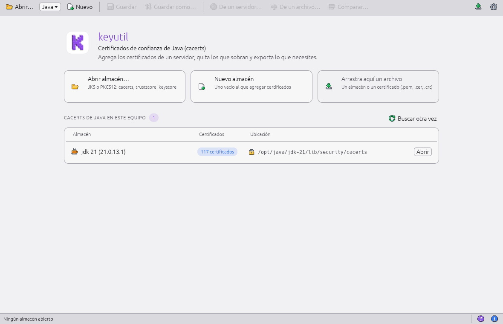
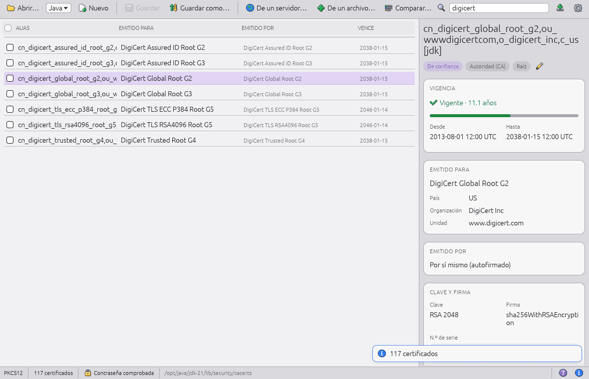

# keyutil

Administra los certificados de confianza de Java (`cacerts`, *truststores*) sin pelearse con
`keytool`: agregar los certificados de un servidor con un clic, quitar y exportar. App de escritorio
en Rust + egui para macOS, Windows y Linux.



## Instalar

macOS y Linux (descarga la última versión publicada; vuelve a ejecutarlo para actualizar o desinstalar):

```bash
curl -fsSL https://raw.githubusercontent.com/airylp/keyutil/main/install.sh | sh
```

Windows (PowerShell):

```powershell
[Net.ServicePointManager]::SecurityProtocol = 'Tls12'; irm https://raw.githubusercontent.com/airylp/keyutil/main/install.ps1 | iex
```

Para compilarlo con lo último de `main`: `… | sh -s -- compilar`.

## Qué hace

- **Abre** almacenes JKS (Java 8) y PKCS12 (Java 9+). Encuentra solo los `cacerts` de los Java
  instalados (JAVA_HOME, `/usr/lib/jvm`, `/Library/Java/JavaVirtualMachines`, `Program Files`,
  SDKMAN, IntelliJ, Gradle…). Prueba la contraseña de fábrica, `changeit`.
- **Agregar de un servidor**: escribe `servidor.ejemplo.com`, una URL `https://…`, `smtp://…:587`,
  `ldaps://…` o una URL `jdbc:…`. Trae la cadena (también con STARTTLS de SMTP, IMAP y POP3), dice si
  Java **ya confía** en ese servidor con ese almacén y, si no, por qué: nombre, vigencia, cadena en
  desorden o incompleta (p. ej. el servidor no manda la intermedia). Completa la cadena hasta la raíz
  con el almacén, los cacerts de los otros Java instalados o descargando los emisores (AIA), y marca
  el certificado más alto que lo arregla (sigue valiendo cuando el servidor renueve el suyo).
- **Agregar de un archivo** `.pem`, `.crt`, `.cer`, `.der` (uno o varios), pegando el PEM (Ctrl+V)
  o arrastrando el archivo a la ventana.
- **Comparar** con otro almacén (el cacerts de otro Java, el de otro servidor…): qué tiene cada uno
  que no tenga el otro, y copiar los que falten.
- **Quitar** y **exportar** (PEM o DER) uno o varios a la vez; marcar los vencidos de un clic.
- **Guardar** en el mismo archivo con una copia del original en la carpeta de respaldos; si el
  `cacerts` es del sistema, pide permisos de administrador (pkexec, macOS o UAC). **Guardar como**
  convierte entre JKS y PKCS12 o cambia la contraseña.
- Las entradas con clave privada se conservan tal cual.

Lo que escribe keyutil lo abren `keytool` de Java 8 y 21 sin errores de integridad (probado con
los `cacerts` reales de ambos).



## Licencia

MIT
